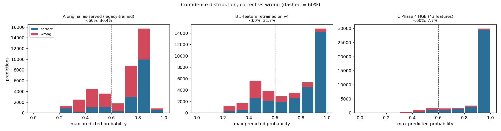
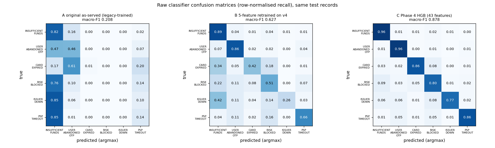

# Phase 5A.2: HGB model comparison (A original, B 5-feature on v4, C Phase 4)

Generated by `eval/phase5_compare.py`; do not edit by hand. Synthetic data only: these numbers measure fit to the simulator, not real Razorpay traffic.

## 1. Setup

| Model | Features | Training data | Train rows | Hyperparameters |
|---|---:|---:|---:|---:|
| A (as-served) | 5 | legacy generator, seed 42, 70% hash split | 14044 | HGB max_iter=200, random_state=0 |
| B (5-feature, v4) | 5 | Phase 3 v4 train worlds (pooled, 12 worlds) | 36672 | HGB max_iter=200, random_state=0 |
| C (Phase 4) | 43 | Phase 3 v4 train worlds (pooled), not retrained | - | {"learning_rate": 0.1, "max_iter": 100, "max_leaf_nodes": 15, "min_samples_leaf": 20, "l2_regularization": 0.1} |

Held-out records: **38,871 failures** from 12 fresh Phase 4 `final_test` worlds (seeds 500000 to 502003), identical for A, B and C. C artifact: `phase4-hgb-deployment_core-uncalibrated-71bf19e4` (calibration: uncalibrated).

**Leakage checks:** B train/test payment_id overlap = 0; shared worlds = none; seed ranges disjoint = True; A train/test payment_id overlap = 0.

**Differences from the as-served model that you must keep in mind:**

* **B is not the serving model.** It uses the same classifier recipe and the same five columns, but it is trained on v4 data (about 3x the rows, v4 vocabulary) with no legacy rules, no 0.25 hard-decline gate and no abstention logic. It isolates the value of the extra features, not the behaviour of the deployed system.
* **A sees a vocabulary it was not trained on.** The legacy generator uses error sources/steps such as `bank` / `authorization`; sequences@v4 uses Razorpay-style values such as `issuer_bank` / `payment_authorization`. See section 6.
* **Different decision policies are reported in separate tables:** A uses its native rules and thresholds; B and C use the frozen 0.60 / 0.03 gate. Raw (argmax) metrics are policy-free and are the only like-for-like comparison.

## 2. Headline: B vs C (raw classifier, policy-free)

| Partition | Failures | B macro-F1 | C macro-F1 | C - B | B acc | C acc | B <60% | C <60% |
|---|---:|---:|---:|---:|---:|---:|---:|---:|
| pooled | 38,871 | 0.627 | 0.878 | +0.251 | 0.740 | 0.912 | 31.7% | 7.7% |
| calm | 9,451 | 0.627 | 0.916 | +0.288 | 0.767 | 0.953 | 29.9% | 4.3% |
| typical | 12,167 | 0.615 | 0.881 | +0.266 | 0.753 | 0.921 | 30.4% | 6.8% |
| stressed | 17,253 | 0.623 | 0.853 | +0.230 | 0.717 | 0.883 | 33.5% | 10.2% |

Paired bootstrap (pooled, 300 draws): macro-F1 gain C - B = +0.251 (95% CI +0.245 to +0.258). Across-world macro-F1 mean +/- sd: B 0.618 +/- 0.015, C 0.882 +/- 0.029.

## 3. All three, raw classifier (pooled)

| Model | Acc | Macro-F1 | <60% | 60-80% | >80% | Acc @>=60% | Mean conf (correct) | Mean conf (wrong) | ECE | Log loss | Brier |
|---|---:|---:|---:|---:|---:|---:|---:|---:|---:|---:|---:|
| A original as-served (legacy-trained) | 0.438 | 0.208 | 30.4% | 27.1% | 42.5% | 51.0% | 0.744 | 0.656 | 0.280 | 2.323 | 0.814 |
| B 5-feature retrained on v4 | 0.740 | 0.627 | 31.7% | 16.5% | 51.9% | 87.3% | 0.807 | 0.553 | 0.006 | 0.665 | 0.346 |
| C Phase 4 HGB (43 features) | 0.912 | 0.878 | 7.7% | 8.8% | 83.5% | 94.8% | 0.941 | 0.646 | 0.006 | 0.244 | 0.125 |

## 4. Per-class precision / recall / F1 (pooled, raw)

| Class | Support | A  P / R / F1 | B  P / R / F1 | C  P / R / F1 |
|---|---:|---:|---:|---:|
| BD_INSUFFICIENT_FUNDS | 13629 | 0.435 / 0.818 / 0.568 | 0.754 / 0.892 / 0.817 | 0.944 / 0.961 / 0.952 |
| BD_USER_ABANDONED_OTP | 11311 | 0.518 / 0.464 / 0.490 | 0.835 / 0.858 / 0.846 | 0.944 / 0.957 / 0.950 |
| CARD_EXPIRED | 3264 | 1.000 / 0.015 / 0.029 | 0.602 / 0.417 / 0.493 | 0.866 / 0.858 / 0.862 |
| RISK_BLOCKED | 4614 | 0.000 / 0.000 / 0.000 | 0.514 / 0.515 / 0.515 | 0.780 / 0.801 / 0.791 |
| TD_ISSUER_DOWN | 2060 | 0.000 / 0.000 / 0.000 | 0.802 / 0.258 / 0.391 | 0.883 / 0.770 / 0.822 |
| TD_PSP_TIMEOUT | 3993 | 0.183 / 0.140 / 0.158 | 0.739 / 0.664 / 0.699 | 0.915 / 0.864 / 0.888 |

Confusion matrices: `confusion_{A,B,C}_raw.csv` and `confusion_matrices.png` in `eval/data/phase5_comparison/`.

## 5. Policy-adjusted behaviour (different policies, do not compare A to B/C directly)

**A, native logic** (native: legacy rules + confidence<0.6 + hard-decline mass>0.25; LLM tier off): AMBIGUOUS rate **32.3%**; stage mix gated:hard_decline_risk 1.9%, gated:low_conf 30.4%, model 67.7%. On decided rows: accuracy 0.517, macro-F1 0.224. Counting AMBIGUOUS as a miss: accuracy 0.350, macro-F1 0.183. Unsafe retries 2615/7878 (33.19%); retryable recall 72.6%.

**B and C, same frozen gate** (frozen gate: confidence 0.60, hard-decline mass 0.03 (eval.safety_pipeline.apply_policy)):

| Model | Abstention | Unsafe retries / hard declines | Unsafe upper 95% | Retryable recall | Retry allowed | Gated macro-F1 | Gated acc |
|---|---:|---:|---:|---:|---:|---:|---:|
| B | 51.2% | 26/7878 | 0.46% | 28.0% | 14.5% | 0.474 | 0.427 |
| C | 15.5% | 38/7878 | 0.63% | 77.6% | 39.7% | 0.833 | 0.811 |

The Phase 4 follow-up policy (`safety-policy@v2`) is **not** applied here; it is not activated.

## 6. A and the legacy vocabulary mismatch

| A input feature | Share of test rows with a level A never saw in training |
|---|---:|
| gw_error_code | 0.0% |
| gw_error_source | 59.8% |
| gw_error_step | 100.0% |
| method | 0.0% |
| instrument_hint | 0.0% |

Rows whose (code, source, step) matches one of A's legacy hard-coded rules: 0.0% (so its rule stage is largely inert on v4). Unseen categories become all-zero one-hot blocks, so part of A's weakness here is data-vocabulary shift, not a lack of features. This is why B, not A, is the baseline for the value of feature engineering.

## 7. Prediction latency (consistent method)

| Model | Median ms | p95 ms | Rows/s (batch, 1 thread) |
|---|---:|---:|---:|
| A original as-served (legacy-trained) | 5.59 | 8.52 | 49082 |
| B 5-feature retrained on v4 | 7.12 | 11.70 | 45057 |
| C Phase 4 HGB (43 features) | 25.18 | 37.45 | 19220 |

Same rows, one thread, one pandas row per request, preprocessing + model (+ calibrator for C). Feature CONSTRUCTION is excluded: A and B read 5 fields of the event; C additionally needs 38 history/window features from a feature store.

## 8. Limitations

* Synthetic sequences@v4 data only; the label is the simulator's cause and `error_reason` is emitted from that cause, so gains from reason-based features are partly a property of the simulator (see `docs/phase4/feature-availability-audit.md`).
* C's extra features need point-in-time history (instrument, issuer, customer windows) that must come from a feature store; A and B do not.
* B was fitted once with seed 0; the across-world spread and the bootstrap interval describe test-sampling noise, not training-seed variance.
* A vs B/C confounds model quality with data-vocabulary shift; only B vs C isolates features.
* Policy-adjusted rows use different policies by design; unsafe-retry counts are small and carry wide upper bounds.
* Latency excludes feature construction and any network/serialization overhead.

## 9. Phase 1 closure notes (added by hand after generation; re-add if this file is regenerated)

* **What the headline means.** On synthetic held-out data, C reaches 91.2% accuracy / 0.878 macro-F1 and B reaches 0.627 macro-F1 on the same 38,871 records. This shows C recovers the simulator's causal story better than B. It does **not** establish real-world performance.
* **Error-reason features carry much of C's gain.** C's 43 features include `error_reason` and features derived from it (`reason_family`, `is_generic_reason`, `instrument_prev_reason`, `same_reason_as_prev`, `instrument_distinct_reasons_24h`, `issuer_timeout_rate_5m`, `issuer_tech_reason_share_5m`). The simulator emits `error_reason` from the true cause, so these are partly circular here; real reasons may be less informative.
* **Vocabulary status.** Sources and steps used by sequences@v4 match Razorpay's per-method parameter docs. The `error_reason` strings (and the `GATEWAY_ERROR` / `SERVER_ERROR` codes) could not be confirmed against the official docs pages reachable in Phase 1; the only reason in those docs is `invalid_otp`, while we use `incorrect_otp`. Reason strings and the reason-to-family mapping are therefore **unverified/assumed**. A's weakness (section 6) also reflects this vocabulary mismatch.
* **Serving integration.** C's 29 merchant-history features are not produced by the current webhook path; building them is Phase 2 work, not a Phase 1 gap.

Runtime of this comparison: 27s.
